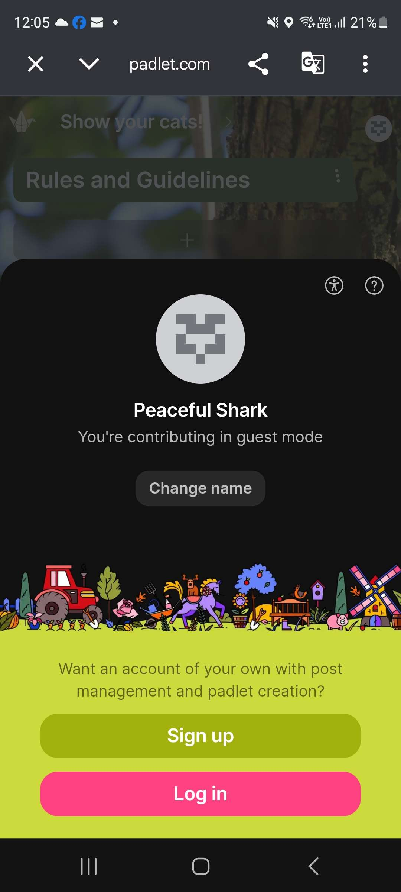
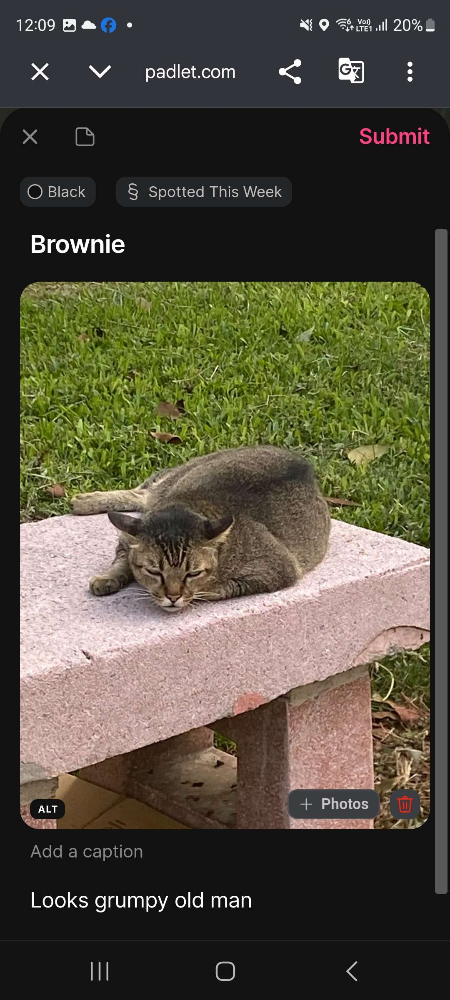
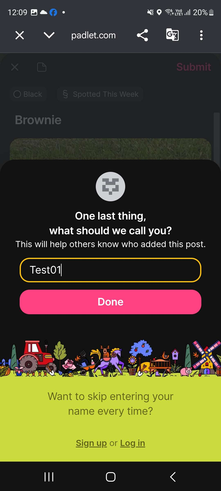
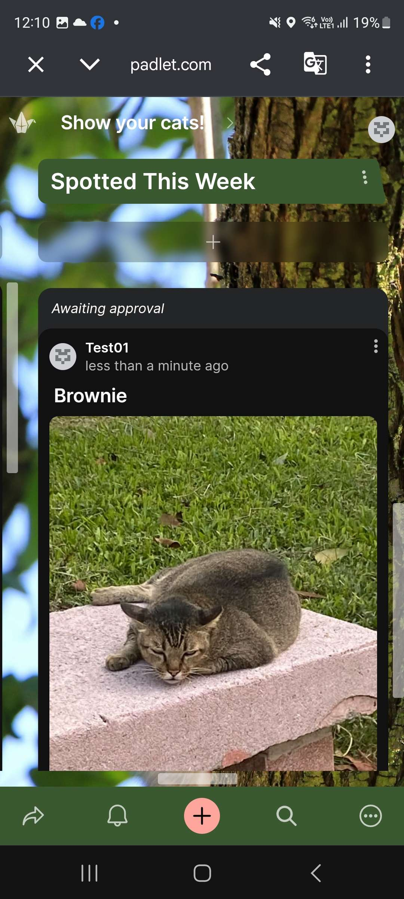
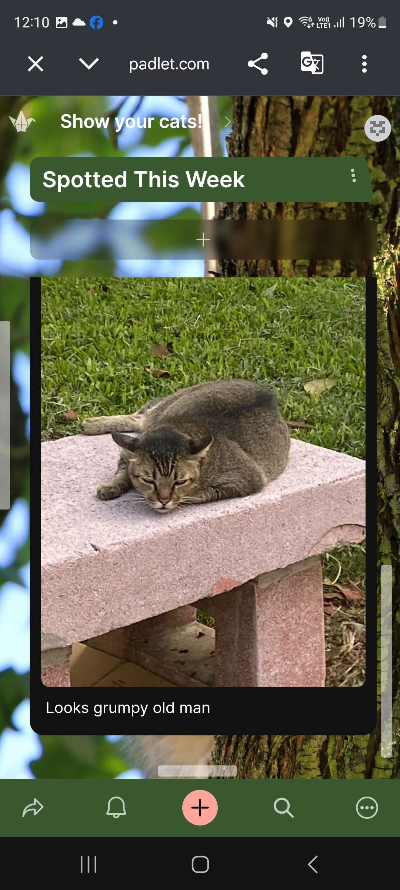
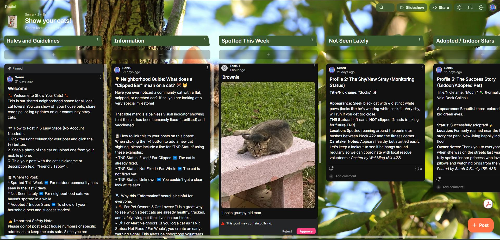

# 🧪 Track 1: Friction vs. Security (Registration Bypass Test)

## 🎯 Objective & Strategic Goal
To maximize neighborhood data collection velocity, this test verifies that the system architecture completely eliminates user onboarding friction by allowing unregistered guests to submit profiles instantly, while simultaneously validating that the background administrative firewall safely quarantines all anonymous data strings prior to public layout rendering.

---

## 🛠️ Testing Methodology & Workflow Execution
To rigorously simulate a genuine newcomer persona without administrative cookies interfering with the results, the following technical execution track was performed:

[Mobile User Sighting] ──> [Bypass Login Wall] ──> [Direct Camera Access] ──> [Asynchronous Submit] ──> [Admin Isolation Queue]

1. **Simulating the Guest Persona:** Opened the secret community board link inside a mobile Incognito (private browsing) window to strip away active host credentials.
2. **Onboarding Friction Check:** Initiated a post generation by clicking the `(+)` action trigger under the `Spotted This Week` column to check for mandatory sign-up walls or OAuth barriers.
3. **Data Payload Transmission:** Uploaded a sample cat profile, appended structural `TNR Status:` data strings, and executed an asynchronous submission.
4. **Firewall Integrity Audit:** Closed the guest portal, logged into the primary host administrator workspace, and evaluated the incoming asset quarantine state.

---

## 📊 Verification Metrics & Logs

### 📸 Test Phase A: The Guest Onboarding Experience
When navigating as a non-registered newcomer, the platform successfully bypassed the traditional account creation funnel entirely. The user interface explicitly generated a *"Contributing in guest mode"* status badge, confirming that direct camera access and content upload were granted with zero user-entry resistance.

*   **Metric - Authentication Barrier:** 0% (Passed). No account sign-up prompt or email verification wall was triggered.
*   **Verification Anchor:** See [Appendix Item A](#📸-appendix-item-a-guest-mode-verification) for visual verification logs.

### 📸 Test Phase B: The Administrative Security Firewall
Upon accessing the primary host dashboard, the test confirmed that background security nets are holding with 100% precision. The inbound anonymous post did not render on the public timeline. Instead, the data record was successfully isolated inside the private administrative hold canvas.

The system perfectly flagged the incoming entry under a system-enforced **"Awaiting approval"** state. The control interface exposed explicit functional tokens (`Approve` and `Reject`) directly on the card asset.

*   **Metric - Routing Isolation Accuracy:** 100% (Passed). Anonymous records are completely quarantined from the open read canvas.
*   **Verification Anchor:** See [Appendix Item B](#📸-appendix-item-b-admin-queue-verification) for visual verification logs.

---

## 🏁 Data Governance Verdict
**PASSED** — The system flawlessly optimizes the tension between security and convenience. By mapping anonymous user submissions straight into a manual moderation bottleneck, the platform achieves a frictionless user onboarding experience while retaining absolute data governance to clear out precise unit numbers before they go live to the block.

---

## 📁 Appendix: Technical Evidence (Visual Assets)

### 📸 Appendix Item A: Guest Mode Verification

🔍 Click to expand: Guest Mode Onboarding Screenshot

### 📸 Appendix Item B: Admin Queue Verification

🔍 Click to expand: Administrative Queue Hold Canvas Screenshot

